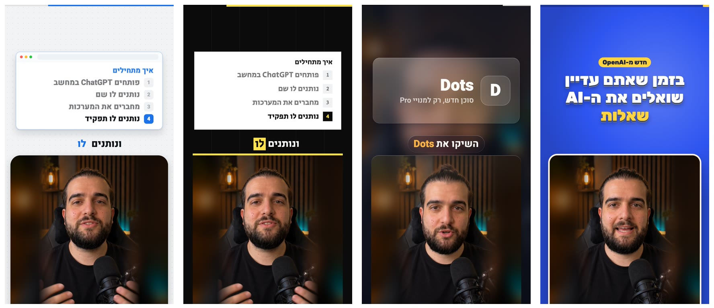

<div dir="rtl">

# סוכן כפול: כל הערכה של הקורס בהורדה אחת



כל מה שהשתמשנו בו בקורס, במקום אחד: הסקיל שמכין ריל מקצה לקצה עם הקול והאווטאר שלכם, ערכת המושן לעריכה, Remotion ו-FFmpeg, כל הפרומפטים מהשיעורים, המצגת המלאה והמדריכים. מתקינים פעם אחת, ומשם פשוט כותבים לקלוד קוד "תכין ריל".

## מתקינים (פעם אחת, 10-15 דקות)

1. פותחים את Claude Code (באפליקציה של Claude, הלשונית Code, כמו בשיעור 6).
2. מעתיקים את השורה הזאת (יש כפתור העתקה בפינה של המסגרת), מדביקים בקלוד קוד ושולחים:

```
https://github.com/peleg-jpg/double-agent-kit תתקין בשבילי
```

3. כשקלוד מבקש אישור להריץ משהו, לוחצים Allow. הוא מתקין הכל לבד, מריץ רינדור ניסיון קצר כדי לוודא שהעריכה עובדת אצלכם, ואומר לכם מה הותקן.
4. בסוף סוגרים את Claude לגמרי ופותחים אותו מחדש, כדי שהסקילים החדשים ייטענו.

זה בדיוק מה שעשינו בשיעור 17 עם ערכת המושן, רק שהפעם הכל נכנס בבת אחת.

## עושים את הריל הראשון

פותחים שיחה חדשה בקלוד קוד וכותבים: **תכין ריל**

בפעם הראשונה קלוד שואל כמה שאלות קצרות: איך קוראים לקול שלכם ב-ElevenLabs, איזו תמונה לשים באווטאר, מי הקהל שלכם, ואיזו מילה אנשים יגיבו כדי לקבל ממכם משהו. משם הוא עובר לבד על כל הדרך: מוצא נושא חם, כותב תסריט, מקריא אותו בקול שלכם, מייצר את האווטאר ב-HeyGen ועורך את הריל עם כתוביות, זומים וכרטיסיות. הוא עוצר לאישור שלכם ארבע פעמים, על הנושא, על התסריט, לפני שהוא מוציא קרדיטים ועל הריל הגמור, ואף פעם לא מפרסם כלום בעצמו.

כבר יש לכם סרטון של האווטאר, או סרטון שצילמתם בטלפון? גוררים אותו לקלוד קוד וכותבים "תערוך לי את הסרטון הזה", והוא קופץ ישר לעריכה.

## לפני הריל הראשון: מחברים את הכלים

את ElevenLabs, HeyGen ו-Apify מחברים לקלוד פעם אחת, דרך Settings ואז Connectors באפליקציה של Claude, בלי שום מפתח API. כל הצעדים קליק אחרי קליק נמצאים ב[מדריך חיבור הכלים](guides/חיבור-הכלים.md), ובקורס רואים את זה בשיעור 7.

| כלי                                                                                                  | בשביל מה          | מנוי                                        |
| ---------------------------------------------------------------------------------------------------- | ----------------- | ------------------------------------------- |
| [Claude](https://claude.com/pricing)                                                                 | המוח שמריץ הכל    | Pro, 20 דולר לחודש                          |
| [ElevenLabs](https://try.elevenlabs.io/25b9ogqs06zn)                                                 | הקול המשוכפל שלכם | Creator, 22 דולר (Starter ב-6 מספיק להתחלה) |
| [HeyGen](https://www.heygen.com/?sid=rewardful&utm_content=creator&utm_medium=influencera&via=peleg) | האווטאר שמדבר     | Creator, 29 דולר                            |
| [Apify](https://www.apify.com?fpr=cikryx)                                                            | מציאת נושאים חמים | החינמי מספיק להתחלה                         |

ריל אחד עולה בערך 2 דולר מהקרדיטים של המנויים. Remotion, FFmpeg והסקילים חינמיים.

## מה יש בערכה

| מה                                           | מה זה עושה                                                                                |
| -------------------------------------------- | ----------------------------------------------------------------------------------------- |
| <span dir="ltr">avatar-twin-reel</span>      | הסקיל הראשי, כל המכונה של הקורס. כותבים "תכין ריל" ומקבלים ריל גמור עם הקול והאווטאר שלכם |
| <span dir="ltr">reel-script-hebrew</span>    | חמישה הוקים ותסריט מתוזמן בעברית, גרסה לקול של ElevenLabs וכיתוב לאינסטגרם                |
| <span dir="ltr">motion-reel-pop</span>       | הופך סרטון מדבר לריל ערוך: כתוביות מילה מילה, זומים, כרטיסיות וכרטיס סיום, ב-4 סגנונות    |
| <span dir="ltr">motion-gsap-explainer</span> | סצנות הסבר מונפשות: מספר שרץ עם גרף, רשימה, לפני ואחרי                                    |
| <span dir="ltr">motion-3d-cinematic</span>   | פתיח וסיום בתלת-ממד, למשל הסרטון שלכם בתוך אייפון שמסתובב                                 |
| הסקילים הרשמיים של Remotion                  | מלמדים את קלוד לערוך וידאו בקוד                                                           |
| Remotion ו-FFmpeg                            | תוכנות העריכה והסאונד                                                                     |
| [prompts](prompts)                           | כל הפרומפטים מהשיעורים, עם אותם מספרים שאומרים בסרטונים                                   |
| [guides](guides)                             | המצגת המלאה, מדריך ערכת המושן, מדריך הבונוס "מהקלטה לקורס" ומדריך חיבור הכלים             |

אחרי ההתקנה הכל מחכה לכם גם במחשב, בתיקייה <span dir="ltr">double-agent</span> שבתיקיית הבית: הפרומפטים, המדריכים, ותיקייה <span dir="ltr">reels</span> שבה נשמר כל ריל שתעשו.

## משהו לא עבד?

מעתיקים לקלוד את מה שכתוב על המסך ושואלים "מה לעשות?". ברוב המקרים מספיק לכתוב לו "תריץ את ההתקנה שוב", זה בטוח להריץ כמה פעמים שרוצים.

במק, אם קפץ חלון שמבקש להתקין developer tools, לוחצים Install, מחכים שיסתיים (5-10 דקות) וכותבים לקלוד "תמשיך".

מעדיפים בלי לינק? לוחצים למעלה על הכפתור הירוק Code ואז Download ZIP, פותחים את הקובץ, גוררים את התיקייה שנפתחה לקלוד קוד וכותבים "תתקין בשבילי".

יצאה גרסה חדשה של הערכה? מדביקים שוב את אותה שורה מלמעלה. ההגדרות שלכם והרילים שעשיתם נשארים במקום.

## מה צריך במחשב

מק או Windows 10/11, אינטרנט, ובערך 3GB פנויים. מודל זיהוי הדיבור שמסנכרן את הכתוביות שוקל 1.5GB ויורד פעם אחת, בריל הראשון, ומנוע העריכה (Remotion והדפדפן שלו) עוד 1GB, פעם אחת לכל הרילים. Remotion חינמי ליחידים ולחברות של עד 3 אנשים, חברה גדולה יותר צריכה [רישיון](https://www.remotion.dev/license).

</div>

---

## For Claude Code

The user pasted this repo's link and asked you to install it. The full instructions are in
[INSTALL_FOR_CLAUDE.md](INSTALL_FOR_CLAUDE.md), raw:
`https://raw.githubusercontent.com/peleg-jpg/double-agent-kit/main/INSTALL_FOR_CLAUDE.md`. Fetch that file and
follow it. In short: download the ZIP and extract it with `tar -xf` (never `unzip` on Mac), read
`install/install-mac.sh` or `install/install-windows.ps1`, run it in the background (the first run takes 10-15
minutes), fix every `[MISSING]` line, then tell the user in Hebrew what was installed and how to connect the tools.
